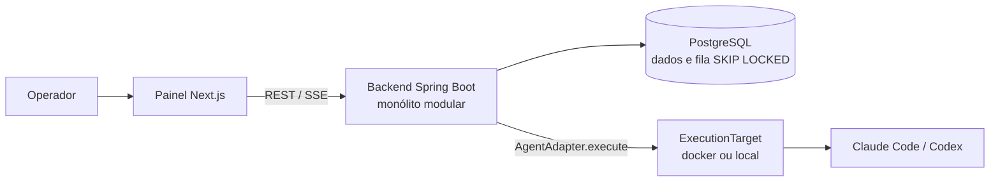

# agente-orquestrator

Control-plane de orquestração de agentes de IA (Java + Next.js), derivado da análise do Paperclip.

- `backend/` — Java 25 + Spring Boot 4.1
- `frontend/` — Next.js 16 + React 19
- `docs/` — arquitetura e ADRs

> Self-hosted control plane that runs AI coding agents per product: atomic issue checkout, budget hard-stop, approval gates and an audit trail. It orchestrates external runtimes (Claude Code, Codex) and does not run the models. In progress.

## Arquitetura



Invariantes principais:

- **Checkout atômico:** `UPDATE` condicional; 0 linhas vira `409`.
- **Budget hard-stop:** estourou, pausa o escopo e cancela os runs em voo.
- **Isolamento por empresa:** toda entidade carrega `company_id`.
- **Deny-by-default:** rota sem checagem de acesso falha fechada.

## Como rodar

Requisitos: Docker e Node.js. As portas 5432 e 8080 precisam estar livres.

```bash
cp .env.example .env
docker compose up -d --build
curl localhost:8080/actuator/health
```

Painel, com `NEXT_PUBLIC_DEV_BOARD_USER` preenchido com um UUID:

```bash
cd frontend
npm ci
npm run dev
```

A imagem do backend não traz a CLI do Docker, então execução de agentes pelo alvo `docker` não funciona dentro do `docker compose` atual.

## Documentação
- [CONTEXT.md](CONTEXT.md) — glossário canônico do domínio
- [docs/ARQUITETURA.md](docs/ARQUITETURA.md) — arquitetura, Constituição, decisões
- [docs/PRD.md](docs/PRD.md) — requisitos do produto
- ADRs:
  - [0001 — Stack, estrutura e invariantes](docs/adr/0001-stack-estrutura-invariantes.md)
  - [0002 — Persistência da Session do adapter](docs/adr/0002-persistencia-session-adapter.md)
  - [0003 — SkillSet × KnowAll](docs/adr/0003-skillset-knowall.md)
  - [0004 — Contrato AgentAdapter.execute()](docs/adr/0004-contrato-agentadapter-execute.md)
  - [0005 — Modelo de heartbeat/execução](docs/adr/0005-modelo-heartbeat-execucao.md)
  - [0006 — Governança em runtime (budget + revisão)](docs/adr/0006-governanca-runtime-budget-revisao.md)
  - [0007 — Modelo de dados de Skills & KnowAll](docs/adr/0007-modelo-dados-skills-knowall.md)
