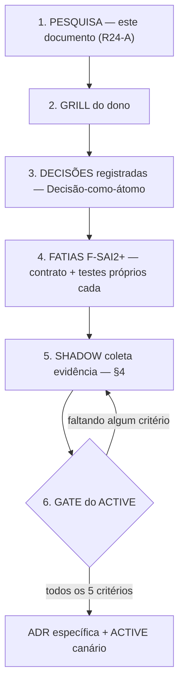

# Pesquisa — melhorias no uso do Spring AI dentro dos limites da Frente E (R24-A)

**Status:** PESQUISA — não implementa, não decide provider, não autoriza `ACTIVE`. Produto da faixa R24-A,
emitida pela sessão de controle em 2026-07-17 sobre a integração `feat/backend-spring-ai-2` (main `4c1b35f`,
integração em voo como R23-A). Toda recomendação abaixo é **PROPOSTA para o grill do dono** — nenhuma decide
nada sozinha.

**Fonte canônica do norte:** verbatim do dono, 2026-07-17 (`scratchpad/racional-spring-ai-verbatim-dono.md`,
reproduzido também no apêndice da ADR-0043). Toda classificação e candidata deste documento se mede contra ele.

**Método:** `/deep-research` (fan-out + verificação adversarial de 3 votos) para o inventário de capacidades e
o panorama de mercado, seguido de verificação direta minha (WebFetch) nos pontos de maior impacto arquitetural
e nas 2 contradições que a pesquisa levantou; `/codebase-design` para o vocabulário de módulos profundos nas
candidatas; `/human-architect-mindset` rodado sobre as recomendações antes de fechar (racional documentado
antes de cada sugestão, não depois).

---

## 1. Capacidades reais do Spring AI 2.0.0

Versão pinada: `spring-ai-bom:2.0.0` (GA 2026-06-12, tag `v2.0.0`), sobre Spring Boot 4.1.0 / Spring Framework
7.0 — confirmado tanto pelo `pom.xml` da tag quanto pelo texto do post de lançamento oficial. Cada claim abaixo
carrega uma marca de confiança:

- **[3 votos]** — sobreviveu à verificação adversarial de 3 votos do `/deep-research` (17 de 122 claims
  extraídas chegaram a esse nível nesta rodada; a rodada não teve orçamento para verificar as 122 inteiras).
- **[confirmado direto]** — eu refiz o fetch da fonte primária pessoalmente depois do `/deep-research`, como
  segunda corroboração independente (mesmo método que a própria verificação adversarial usa para as claims mais
  fortes: ler o texto pinado da doc/source diretamente).
- **[extraído]** — extraído de fonte primária com citação verbatim por um agente de busca, mas não passou pelo
  voto de 3 (o orçamento da rodada priorizou outras 3 áreas). Specificidade técnica alta (nomes de classe, valor
  default, assinatura) reduz o risco de fabricação, mas não é o mesmo nível de prova que os dois anteriores.

### 1.1 Advisors
API split em `CallAdvisor`/`StreamAdvisor`, ambos estendendo `Advisor`→`Ordered` (tipo nativo do Spring
Framework); a chain funciona como pilha (1º advisor a ver o request é o último a ver a response).
**[3 votos]** — [Advisors API](https://docs.spring.io/spring-ai/reference/api/advisors.html).

O achado mais importante desta seção: **`ChatClient` sempre auto-registra um `ToolCallingAdvisor` na chain por
padrão — mesmo com zero tools estaticamente configuradas** — inclusive em `ChatClient` construído manualmente,
não só via autoconfiguração. Confirmado por duas fontes independentes e por refetch direto meu.
**[3 votos] + [confirmado direto]** —
[Advisors API](https://docs.spring.io/spring-ai/reference/api/advisors.html),
[ChatClient](https://docs.spring.io/spring-ai/reference/api/chatclient.html). Propriedade para desabilitar:
`spring.ai.chat.client.tool-calling.enabled=false` (default `true`). A justificativa oficial para o
auto-registro é permitir que tools injetadas dinamicamente por outro advisor em runtime funcionem mesmo sem
tools estáticas na chamada — não há forma documentada de verificar em runtime que a chain está livre da
*machinery*, só desabilitar a flag explicitamente ou fornecer um advisor customizado que suprime o
auto-registro.

O roster específico de advisors prontos (`QuestionAnswerAdvisor`, `RetrievalAugmentationAdvisor`,
`SafeGuardAdvisor` etc.) foi **proposto e refutado (0-3)** na verificação adversarial — não citar essa lista sem
reconferir `advisors.html` diretamente; não é matéria desta pesquisa.

### 1.2 Structured output
`BeanOutputConverter` deriva JSON Schema (draft 2020-12) da classe/record Java alvo via `FormatProvider`;
funciona nativamente com records Java. **[3 votos, 2×]** —
[Structured Output Converter](https://docs.spring.io/spring-ai/reference/api/structured-output-converter.html).

`.validateSchema()` no `entity()` ativa `StructuredOutputValidationAdvisor` (auto-registrado só quando chamado,
nada a conectar manualmente): valida o JSON contra o schema e, em falha, anexa o erro de validação ao prompt e
reinvoca o modelo — até `maxRepeatAttempts=3` por padrão (até 4 chamadas totais), 100% client-side/in-process.
**[3 votos, 3×]** — [self-correcting structured output](https://spring.io/blog/2026/06/23/spring-ai-self-correcting-structured-output/).

Limitação documentada relevante ao adapter atual: providers que anunciam suporte nativo a JSON Schema têm
conformidade parcial ($ref, arrays aninhados, `allOf`/`anyOf`/`oneOf`, regex e tipos recursivos comumente não
suportados). Para **Ollama especificamente**, modelos com modo de raciocínio ("thinking") — a doc cita
`qwen3:8b`, `qwen3.5:9b` e variantes mais novas da família Qwen — podem devolver o raciocínio interno como texto
plano em vez de JSON válido, quebrando a deserialização (`StreamReadException`); workaround documentado = trocar
de modelo ou usar o modo prompt-based (não-nativo). **[3 votos, 3×]**. **Relevância direta**: o adapter em
produção roda `qwen3:0.6b`, da mesma família citada no caveat — a doc não confirma o `0.6b` especificamente,
mas o risco de família é real.

### 1.3 Observability/metrics
**[confirmado direto, 2 fontes concordantes]** —
[Observability](https://docs.spring.io/spring-ai/reference/observability/index.html).

- `spring.ai.chat.observations.log-prompt` e `.log-completion` = **`false`** por padrão (variantes
  `spring.ai.chat.client.observations.*` idem). Aviso oficial repetido: "existe risco de expor informação
  sensível ou privada" se habilitado. **Os nomes de propriedade batem exatamente com o `application.yml` já em
  produção na branch** (`log-prompt: false`, `log-completion: false`, `include-error-logging: false`) — o
  adapter atual já segue a configuração recomendada pela doc oficial, não inventou nada aqui.
- Métricas nativas Micrometer/OTel: `gen_ai.client.operation` (timer de latência/contagem por chamada
  `call()`/`stream()`) e `gen_ai.client.token.usage` (contador de tokens input/output/total, label
  `gen_ai_token_type`); tokens de cache-write vs. cache-read do provider rastreados como atributos de trace
  dedicados.
- Limitação conhecida de tracing: em chamadas **streaming** (OpenAI/Anthropic), o span HTTP não fica aninhado
  sob o span do chat-model — o path assíncrono do SDK troca de thread (`ForkJoinPool.commonPool()`) antes de
  invocar o HTTP client do Spring AI, perdendo o contexto de observação nessa fronteira. Chamadas síncronas (o
  modo atual do adapter) não têm esse problema.

### 1.4 Evaluation/testing
**[extraído, alta especificidade de nomes de classe/API — baixo risco de fabricação]** —
[Testing](https://docs.spring.io/spring-ai/reference/api/testing.html),
[LLM-as-a-Judge](https://docs.spring.io/spring-ai/reference/guides/llm-as-judge.html).

- `RelevancyEvaluator`: avalia se a resposta é relevante ao contexto RAG recuperado — LLM-as-judge; guidance
  oficial recomenda usar um modelo diferente (idealmente "o melhor disponível") do que gerou a resposta.
- `FactCheckingEvaluator`: detecta/reduz alucinação verificando se uma claim é logicamente suportada por um
  documento; também LLM-as-judge; cita modelos dedicados menores (ex.: Bespoke's Minicheck) como opção mais
  barata.
- API mínima: `Evaluator.evaluate(EvaluationRequest): EvaluationResponse` (`@FunctionalInterface`).
- `SelfRefineEvaluationAdvisor`: feature **experimental** (desde 1.1.0-M4+), não-streaming only; usa modelo
  separado como juiz para evitar bias de auto-avaliação; não trava o fluxo indefinidamente (após
  `maxRepeatAttempts` configurável, default 15, devolve a última resposta); saída do juiz é um record
  estruturado fixo (`rating: int, evaluation: String, feedback: String`); guidance oficial recomenda config
  determinística do juiz **e "manter supervisão humana para decisões de alto risco"** — coerente com o próprio
  racional do dono (evolução por evidência, decisão humana no gate do `ACTIVE`).

### 1.5 RAG/embeddings/VectorStore (PGvector)
**[extraído, alta especificidade]** — [PGvector](https://docs.spring.io/spring-ai/reference/api/vectordbs/pgvector.html).

- Índice HNSW (default) suporta no máximo **2000 dimensões** de embedding.
- Auto-inicialização de schema é **opt-in**, default `false` (`initializeSchema` ou
  `spring.ai.vectorstore.pgvector.initialize-schema=true`) — a doc marca isso como *breaking change* (era
  automático antes).
- Métrica de distância default = `COSINE_DISTANCE`; configurável para `EUCLIDEAN_DISTANCE` ou
  `NEGATIVE_INNER_PRODUCT`.
- Filtro de metadados: expressão textual + DSL Java programático (ex.:
  `filterExpression("author in ['john','jill'] && article_type == 'blog'")`), traduzida para JSON path do
  Postgres. **Isso é filtro de atributo, não busca híbrida BM25+vetor documentada** — a página não descreve
  hybrid search lexical+semântico nativo. Isso corrige a premissa de "busca híbrida nativa" para a candidata de
  KnowAll na seção 3: híbrido aqui significa orquestrar trigram (`pg_trgm`, já existe) + embedding semântico na
  camada de aplicação, não um recurso único do PGvector.

### 1.6 Tool calling e segurança
**[confirmado direto + extraído]** — [Tool Calling](https://docs.spring.io/spring-ai/reference/api/tools.html).

- "O modelo nunca tem acesso direto a nenhuma API fornecida como tool" — só solicita a chamada, a aplicação
  cliente executa; a doc chama isso explicitamente de consideração crítica de segurança. É a **única**
  afirmação de segurança explícita da página — não cobre prompt injection via conteúdo de tool nem execução
  arbitrária de função pelo próprio Spring AI.
- **Achado de segurança real (advisory formal, não apenas doc)**: GHSA/[CVE-2026-22738](https://github.com/advisories/GHSA-fvh3-672c-7p6c)
  — injeção SpEL (Spring Expression Language) em `SimpleVectorStore` quando um valor fornecido pelo usuário é
  usado como **chave** de expressão de filtro. CVSS 3.1 = **9.8 CRITICAL**
  (`AV:N/AC:L/PR:N/UI:N/S:U/C:H/I:H/A:H`). Afeta `>=1.0.0 <1.0.5` e `>=1.1.0-M1 <1.1.4`; corrigido em
  `1.0.5`/`1.1.4` — portanto **já corrigido antes do 2.0.0 GA**, não é vulnerabilidade aberta na versão pinada,
  mas é precedente direto de classe de risco. Regra prática clara para qualquer uso futuro de VectorStore: nunca
  construir `filterExpression` a partir de input de usuário não validado.
- **Gap confirmado**: tool-calling do Spring AI não tem mecanismo de aprovação/gating plugável nativo — uma vez
  que o modelo decide chamar uma tool, a execução é automática, sem ponto de interceptação. Existe uma proposta
  de design (`ToolApprovalStrategy`) em GitHub Discussion **aberta, não mergeada, autoria comunitária** (ainda
  em "shape" em 2026-06-25) — não tratar como capacidade existente.

### 1.7 Chat memory
A claim mais robustamente corroborada de toda a pesquisa: **4 claims separadas, de 3 páginas oficiais
diferentes, convergindo**, com leitura direta do source pinado `v2.0.0`. **[3 votos, 4×]** —
[Chat Memory](https://docs.spring.io/spring-ai/reference/api/chat-memory.html),
[Upgrade Notes](https://docs.spring.io/spring-ai/reference/upgrade-notes.html).

- Memória é estritamente **opt-in**: só ativa se um advisor de memória (`MessageChatMemoryAdvisor` ou
  `VectorStoreChatMemoryAdvisor`) for adicionado explicitamente à chain. `ChatMemoryAutoConfiguration` do Spring
  Boot só registra os beans `ChatMemory`/`ChatMemoryRepository` — **nunca** conecta automaticamente num
  `ChatClient`.
- Uma vez adicionado, `ChatMemory.CONVERSATION_ID` é **obrigatório, sem default**: a constante
  `DEFAULT_CONVERSATION_ID` (existia na 1.x) e os métodos `.conversationId()` do builder foram **removidos** — a
  chamada que omite o ID lança `IllegalArgumentException` imediatamente, em vez de cair num contexto
  compartilhado/implícito. É exatamente o vetor de vazamento implícito que a 1.x tinha, fechado estruturalmente
  na 2.0.0, não por convenção.
- Relevância direta: um adapter que registra zero advisors (o caso atual) tem **zero** comportamento de chat
  memory, implícito ou não — por construção do framework, não por disciplina do time.

### 1.8 Model Context Protocol (MCP)
**[confirmado direto — refetch resolveu uma contradição real entre duas fontes do `/deep-research`]** —
[MCP Overview](https://docs.spring.io/spring-ai/reference/api/mcp/mcp-overview.html).

- Spring AI 2.0 exige **MCP Java SDK 1.0.0 (RC1 ou posterior)** — subiu de `0.18.x`. (Uma claim vinda do post de
  lançamento dizia "SDK 2.0.0"; o refetch direto da página de referência específica de MCP não confirma essa
  versão — tratando `1.0.0` como o fato correto e a claim do blog como não corroborada.)
- Transporte default = **SSE** (`spring.ai.mcp.server.protocol=SSE` ou vazio) — confirmado no refetch,
  contradizendo outra claim não verificada que dizia "Streamable HTTP substituiu SSE como default".
- Suporte a client E server: starters `spring-ai-starter-mcp-client`(-webflux) e múltiplas variantes de server
  (STDIO, WebMVC, WebFlux × SSE/Streamable-HTTP/Stateless-Streamable-HTTP).
- Modelo de anotação declarativo no lado servidor (`@McpTool`, `@McpResource`, `@McpPrompt`, `@McpComplete`) —
  mecanismo separado da configuração programática e da API nativa `ToolCallback`.
- Tools locais `@Tool` e tools MCP remotas compartilham a **mesma** interface `ToolCallback` uma vez
  registradas — modelo e `ToolCallingAdvisor` não distinguem origem em tempo de chamada. MCP é definido como
  camada de protocolo separada do tool-calling nativo, não o mesmo mecanismo.
- **A página de segurança MCP dedicada está marcada "(WIP)"** — não há guidance oficial completa de segurança
  MCP nesta versão.

### 1.9 Providers/starters
**[confirmado direto — refetch bate exatamente com a 2ª passada de extração do `/deep-research`]** —
[Chat Models Comparison](https://docs.spring.io/spring-ai/reference/api/chat/comparison.html).

A tabela oficial de comparação lista exatamente **11 providers de chat**: Anthropic Claude, DeepSeek
(proxy OpenAI), Google GenAI, Groq (proxy OpenAI), Mistral AI, MiniMax (proxy Anthropic), NVIDIA (proxy OpenAI),
Ollama, OpenAI, Perplexity (proxy OpenAI), Amazon Bedrock Converse. Colunas: Multimodality, Tools/Functions,
Streaming, Retry, Observability, Built-in JSON, Local, OpenAI API Compatible.

Achados que corrigem a premissa original desta pesquisa:
- **"Azure OpenAI" não aparece como linha própria** nesta tabela (só na navegação lateral).
- **"Vertex AI" e "HuggingFace" não aparecem em lugar nenhum** — o starter oficial do Google na 2.0.0 se chama
  **Google GenAI** (SDK único), não "Vertex AI Gemini"; Vertex aparece só na seção de Embedding Models da nav,
  não como chat provider.
- Ollama é a única linha com `Local = yes`. Anthropic Claude: `Retry=yes, Observability=yes, Built-in JSON=no,
  Local=no`.

**[3 votos]** — post oficial confirma que a 2.0 **estreitou deliberadamente** o conjunto core out-of-the-box
(OpenAI, Anthropic, Amazon Bedrock, Google GenAI, Mistral AI, DeepSeek, Ollama), consolidando variantes prévias
(OpenAI Azure/HTTP/SDK → 1 SDK único; Google GenAI+Vertex → 1 SDK único; Anthropic HTTP/SDK → 1 SDK único,
reaproveitado pelo MiniMax via endpoint compatível). Outras integrações (OCI Generative AI, Azure Cosmos DB
vector store) passaram a ser mantidas por terceiros, fora do core. HuggingFace não está no conjunto core.

Ollama especificamente: `spring.ai.ollama.init.pull-model-strategy` default = **`never`** — confirma que o
comportamento já em uso no `application.yml` da branch é o default recomendado, não uma escolha isolada. A doc
marca "não recomendado para produção" o auto-pull, com admonição CAUTION (não só nota de implementação). Requer
Ollama server ≥0.2.8 para function calling, ≥0.4.6 para function calling em streaming. `OllamaChatModel`
implementa `StreamingChatModel` (`Flux<ChatResponse>` reativo).

### 1.10 Resiliência
**[extraído, específico o bastante para confiar, com uma lacuna explícita]** —
[`RetryUtils`](https://docs.spring.io/spring-ai/docs/current/api/org/springframework/ai/retry/RetryUtils.html).

`RetryUtils` (pacote `org.springframework.ai.retry`) — classe nativa, **não é novidade da 2.0.0** (existe desde
0.8.1). Expõe `DEFAULT_RETRY_TEMPLATE` (backoff exponencial, tipo `org.springframework.core.retry.RetryTemplate`
— API nativa do Spring Framework, não a lib externa `spring-retry` legada) + `DEFAULT_RESPONSE_ERROR_HANDLER`
(classifica erro HTTP para retry) + `SHORT_RETRY_TEMPLATE` (cenários de teste).

**Pergunta em aberto, não respondida por nenhuma fonte encontrada**: não está confirmado se isso é aplicado
automaticamente em toda chamada `ChatModel`/Ollama por padrão, ou se precisa de wiring explícito. Os testes do
adapter atual (`SpringAiContextIntelligenceTest`) mostram 429/5xx virando `FALLBACK` imediato — sem evidência de
retry automático em voo hoje. A tabela de comparação (§1.9) tem coluna "Retry = yes" para quase todos os
providers, o que sugere aplicação automática, mas nenhuma fonte confirma o texto explicitamente. Fica como
pergunta empírica para quem avaliar a candidata de resiliência (§3).

---

## 2. Mapa capacidade × norte

Classificação contra o verbatim do dono + a Constituição de 10 regras do plano de implementação.
**PERMITIDA** = usável hoje sem gate novo · **PROIBIDA** = viola regra dura, não entra por nenhuma fatia ·
**CONDICIONADA** = usável só sob um gate/decisão específica (indicado na coluna).

| Capacidade (§1) | Classificação | Gate / condição |
|---|---|---|
| Advisor chain (mecanismo genérico) | CONDICIONADA | permitido como padrão de interceptação **só** para advisors escritos pelo próprio produto, que respeitem as 10 regras da Constituição — não os advisors prontos do Spring AI sem auditoria individual |
| `ToolCallingAdvisor` | **PROIBIDA** | racional: "NÃO deve... executar tools" (dura, sem exceção). Achado do §1.1: é auto-registrada por padrão mesmo sem tools — precisa desabilitação **explícita** (`tool-calling.enabled=false`), não apenas ausência de `ToolCallback` beans |
| `MessageChatMemoryAdvisor`/`VectorStoreChatMemoryAdvisor` | **PROIBIDA** | racional + Constituição #4 ("sem terceira memória"). Já é opt-in por design (§1.7) — adapter atual já cumpre por construção (zero advisors registrados) |
| `BeanOutputConverter` / structured output básico | PERMITIDA | é o mecanismo que já sustenta `ContextAssessment` hoje |
| `.validateSchema()` auto-retry | CONDICIONADA | precisa caber no orçamento de timeout existente (regra #3, falha assimétrica) **e** avaliação empírica contra o caveat do Qwen (§1.2/§3) antes de adotar |
| Observability nativa (Micrometer/OTel `gen_ai.client.*`) | CONDICIONADA | metadados, não conteúdo — permitido em princípio, mas depende de decisão de superfície de exposição do actuator (hoje só `health`) |
| Log de prompt/resposta (`log-prompt`/`log-completion`) | **PROIBIDA** (manter `false`) | racional explícito; já cumprido por config atual |
| `RelevancyEvaluator`/`FactCheckingEvaluator`/`SelfRefineEvaluationAdvisor` | CONDICIONADA | só como ferramenta OFFLINE de apoio ao rotular o conjunto dourado (§4) — **nunca** dentro do caminho do `ContextIntelligence` de produção (isso dobraria chamadas de modelo por assessment e começaria a borrar a linha "SHADOW não influencia execução") |
| `EmbeddingModel` + `VectorStore` (PGvector) | CONDICIONADA | só para metadados de Skill (Constituição #9), nunca body redigido, nunca Decision-log; filtro de expressão nunca construído a partir de input de usuário não validado (precedente CVE §1.6) |
| Tool calling / `@Tool` / `ToolCallback` | **PROIBIDA** | racional explícito; sem gate de aprovação nativo no framework (§1.6) reforça a proibição — o próprio ecossistema ainda não tem resposta de segurança para isso |
| MCP client/server | **PROIBIDA** para este módulo | Constituição #10 ("Spring AI não vira `AgentAdapter`") — MCP aqui seria justamente isso; já existe uma integração MCP separada e não relacionada para o KnowAll (fora do escopo desta frente) |
| Providers/starters (troca de adapter) | PERMITIDA como padrão arquitetural | é o próprio seam `ContextIntelligence` já existente; **qual** provider é CONDICIONADA ao gate H1 do `ACTIVE` |
| Auto-pull de modelo Ollama | **PROIBIDA** (manter `never`) | racional explícito; já é o default oficial (§1.9), não uma escolha isolada do produto |
| `RetryUtils` nativo | CONDICIONADA | precisa confirmar empiricamente se já está em uso implícito antes de decidir adotar/trocar o mecanismo hand-rolled atual |
| Chat memory implícita | **PROIBIDA** | fechada estruturalmente pelo próprio framework na 2.0.0 (§1.7) — reforça, não substitui, a proibição do racional |

---

## 3. Candidatas F-SAI2+ ranqueadas

Cada candidata usa o vocabulário de módulos profundos (`/codebase-design`): módulo/interface/seam/adapter/
deletion-test. Ordenadas por valor/risco depois da revisão via `/human-architect-mindset` — o racional de cada
uma vem antes da recomendação, não depois.

### 0. Achado (não é fatia nova) — hardening da F-SAI1 já fechada
**Setar `spring.ai.chat.client.tool-calling.enabled=false` explicitamente** no builder do
`SpringAiContextIntelligence`, com um assert novo na suíte já existente confirmando zero advisors na chain.

**Racional**: o resto do módulo já segue um padrão deny-by-default *ativo* — `ContextPolicy.
validatePublishedPaths` rejeita `.orq/*` proativamente, `ContextAssessmentValidator` rejeita achado fora da
allowlist proativamente. Hoje o único ponto que depende de **ausência** (nenhum `ToolCallback` bean em qualquer
lugar do Spring context) em vez de **rejeição estrutural** é justamente a regra mais dura do racional
("executar tools"). Isso é inconsistente com o resto do próprio módulo, não apenas uma precaução extra. Não é um
bug hoje (a chain está inerte, sem tools para chamar) — é fechar a mesma garantia que o resto do código já dá
por construção.

**Custo**: uma linha de config + um assert de teste, sobre código já mergeado. Sem contrato novo, sem migration.

### 1a. Harness comparativo multi-modelo, dentro do Ollama
**Contrato**: nenhum módulo novo — extensão de configuração do `ContextIntelligence` existente, permitindo N
beans concorrentes (um por combinação provider+model) em vez de 1, todos gravando na mesma tabela
`context_assessment` (que já é keyed por `provider+model+prompt_version+source_hash` — cabe sem migration).

**Racional**: hoje só um modelo (`qwen3:0.6b`/Ollama) já rodou de fato. A "estabilidade por modelo/provider" que
o racional pede como evidência do gate do `ACTIVE` está, literalmente, vazia — não existe comparação real. Isso
é o gap mais concreto e barato de fechar de toda a pesquisa.

**Deletion test**: desligar o 2º bean = comportamento idêntico ao SHADOW single-provider de hoje.

**Risco identificado na revisão de systems-thinking**: `workerThreads`/`queueCapacity` do
`SpringAiContextIntelligence` são dimensionados hoje para 1 adapter. Rodar 2 em paralelo sem reajustar aumenta
`QUEUE_FULL` artificial — o que contaminaria a própria evidência de "estabilidade" que a candidata quer
produzir. Precisa de retuning, não é *zero-touch*.

**Por que fica em 1a, não junto com 1b**: comparar dois tamanhos/famílias de modelo **dentro do Ollama** não
cruza nenhuma fronteira de egress — zero decisão nova precisa do dono. Ver 1b abaixo para o motivo de separar.

### 1b. Harness comparativo cruzando para um provider cloud — NÃO é uma fatia livre
**Achado da revisão `/human-architect-mindset`, mais importante desta seção**: meu instinto inicial era tratar
"comparar 2 providers" como uma única candidata quase-de-graça (reaproveita o schema existente). Isso está
errado assim que o 2º provider é uma API cloud. Nesse momento, a candidata já está tocando exatamente a decisão
que o racional reserva ao gate do `ACTIVE`: *"Antes do ACTIVE, decidir: provider; envio de dados a serviços
externos; quais dados podem sair"*. Rodar esse experimento — mesmo em SHADOW, mesmo com dado redigido/allowlist
— já é fazer dado da empresa sair da infra antes que o dono tenha aprovado isso, mesmo que seja só para gerar
evidência.

**Não recomendo implementar 1b nesta frente.** Recomendo, em vez disso, que o dono decida no grill se quer
**pré-aprovar um experimento limitado e nomeado** (1 provider específico, dado redigido/allowlist, só para
SHADOW, com teto de volume/custo) antes do gate completo do `ACTIVE` — isso é uma pergunta a fazer a ele, não
uma fatia que já nasce autorizada.

### 2. F-SAI4 — busca híbrida do KnowAll (refinada)
**Contrato**: o seam `SkillSearch` já existe e já é real (2 adapters hoje: `PgTrgmSkillSearch` prod,
`SubstringSkillSearch` H2 teste — pelo critério de `/codebase-design`, "1 adapter é seam hipotético, 2 adapters
é seam real"). Um 3º adapter híbrido (trigram + embedding) estende o seam existente, não cria um novo.

**Correção desta pesquisa**: PGvector não tem busca híbrida BM25+vetor nativa documentada (§1.5) — "híbrido"
aqui significa orquestrar `pg_trgm` (já existe) + ranking semântico via `EmbeddingModel` na camada de
aplicação, acima do `SkillSearch` atual.

**Achado da revisão**: não há, nesta pesquisa, evidência de que `PgTrgmSkillSearch` tenha um problema de recall
*medido* — o plano de implementação **propõe** a melhoria, não **confirma** a lacuna. Investir em pgvector +
`EmbeddingModel` para um problema não medido contraria a própria lição da fase de descoberta de bugs deste
projeto ("testar pelo produtor real, nunca por fixture"). **Recomendo condicionar esta candidata a um pré-passo
barato**: medir recall@5 do `pg_trgm` atual num pequeno conjunto de queries reais antes de justificar a infra
nova (dependência nova: `EmbeddingModel` + extensão `pgvector`, indexação after-commit, reconstruível por
`skillId+contentHash`).

**Deletion test**: remover o adapter híbrido = volta a `PgTrgmSkillSearch` puro, zero acoplamento.

**Limite herdado (Constituição #9)**: embeddings só de metadados de Skill (`name+description+triggers`) —
nunca o body redigido, nunca Decision-log (deliberadamente sem vetor).

### 3. F-SAI2 — qualidade do handoff (refinada)
**Contrato**: interface pequena paralela a `ContextIntelligence.View`, mas escopada ao `HandoffNote`
(`.orq/handoff/<conversationId>.md`, zero schema — "lugar não linha") + fontes flexíveis permitidas do Run.

**Achado da revisão**: o bilhete é texto livre — avaliar isso é uma forma diferente de "lintar fontes
estruturadas" que o `ContextAssessment` atual já faz (severidade/categoria/ação sugerida foram desenhados para
achados sobre `ContextSource`, não para texto livre). Provavelmente precisa de um contrato de saída distinto,
não reuso direto do `ContextAssessment`.

**Ajuste de seam (revisão de systems-thinking)**: **não** deve ser invocada de dentro de
`ContextHandoffLoop.afterCeoTurn()`, mesmo assíncrona — esse loop já é um mecanismo best-effort deliberadamente
minimalista ("nunca reabre o turno já liquidado"), e acoplar qualquer coisa nova ao mesmo call site aumenta o
risco de interação com uma rede de recuperação já frágil. Deve ser um gatilho **totalmente desacoplado**
(ex.: leitura periódica/pós-fato de `.orq/handoff/*.md`), não um hook no mesmo ponto do linter de contexto.

**Deletion test**: remover o módulo = `ContextHandoffLoop`/`HandoffThresholdDetector` funcionam idênticos a
hoje.

**Evidência que justificaria promover**: conjunto dourado de bilhetes reais revisados pelo dono (já citado no
plano) + contagem de lacunas/contradições achadas pelo SHADOW vs. julgamento humano — ver §4 para como usar
`RelevancyEvaluator`/`SelfRefineEvaluationAdvisor` como *bootstrap* offline dessa amostra.

### 4. Observability nativa via actuator — prioridade rebaixada
**Contrato**: expor `gen_ai.client.token.usage`/`gen_ai.client.operation` via um endpoint actuator escopado
(hoje só `health` está exposto).

**Achado da revisão**: o valor incremental sobre SQL puro no schema já existente (`latency_ms`,
`input_tokens`/`output_tokens`, `cache_hit` já persistidos por linha) é pequeno — percentis e séries temporais
já saem de agregação SQL direta. Só compensa se já existir um stack Prometheus/Grafana consumindo isso na
operação, o que **não foi confirmado nesta pesquisa**. Além disso, expor qualquer endpoint além de `health` é
decisão de superfície de rede, não puramente config — precisa da mesma postura de segurança que o resto do
actuator já tem hoje.

**Recomendação**: manter em standby; só revisitar se a operação já tiver (ou decidir montar) um consumidor de
métricas Prometheus.

### 5. `validateSchema()` auto-retry nativo — não recomendado agora
**Contrato**: substituir/complementar o parse manual + `ContextAssessmentValidator` hand-rolled por
`StructuredOutputValidationAdvisor` nativo.

**Achado da revisão, mais específico que "algum risco"**: o mecanismo de retry funciona anexando a mensagem de
erro de validação ao prompt e reinvocando o modelo. Se a causa raiz do `INVALID_RESPONSE` do `qwen3` for vazar o
raciocínio como texto solto — comportamento **estrutural** do modo "thinking" do modelo (§1.2) — um erro de
validação anexado ao prompt provavelmente **não muda esse comportamento**: o retry tende a reproduzir a mesma
falha, gastando latência/custo por um ganho esperado baixo especificamente com este modelo.

**Recomendação**: não adotar agora; reavaliar só se/quando a decisão de provider (gate H1) mudar para um modelo
fora da família com esse caveat documentado.

---

## 4. Desenho da coleta de métricas SHADOW

Desenho apenas — a coleta futura de métricas SHADOW está explicitamente fora do escopo de implementação desta
frente. O schema já existente (`V31`: `run_context_manifest` + `context_assessment`) cobre a maior parte sem
nenhum código novo.

### 4.1 Já coberto por SQL puro sobre o schema atual (zero código novo)
| Métrica pedida pelo racional | Fonte |
|---|---|
| Latência | `latency_ms` por linha, agregável por percentil/provider/model |
| Taxa de fallback | `COUNT(fallback_reason IS NOT NULL) / COUNT(*)`, quebrável por `fallback_reason` (`TIMEOUT`, `RATE_LIMITED`, `PROVIDER_5XX`, `INVALID_RESPONSE`, `UNAVAILABLE`, `EXCEPTION`, `QUEUE_FULL`) |
| Consumo de tokens/custo | `input_tokens`+`output_tokens` já persistidos — falta só multiplicar pelo preço do provider (config/política, não código) |
| Estabilidade por modelo/provider | `GROUP BY provider, model, date_trunc(...)` — série temporal de fallback rate/latência (viabilizado de fato pela candidata 1a da §3) |
| Taxa de cache hit | `cache_hit` já persistido |

### 4.2 Não coberto — precisão/FP-FN dos achados (exige rótulo humano)
O schema não tem um campo de veredito — `findings` (jsonb) registra o que o modelo disse, não se estava certo.

- **Amostragem**: query periódica read-only sobre `context_assessment WHERE status='FINDINGS'`, apresentada ao
  dono/operador como "conjunto dourado" — mesmo padrão que a F-SAI2 do plano já usa para bilhetes de handoff.
  Veredito registrado em artefato versionado **fora** do banco de produção (doc/planilha); só vira schema novo
  se a promoção quiser rotular em escala.
- **Bootstrap semi-automático**: `RelevancyEvaluator`/`SelfRefineEvaluationAdvisor` (§1.4) rodados **offline**,
  fora do caminho do `ContextIntelligence` de produção, podem pré-triagem uma amostra maior antes da revisão
  humana final — reduzindo o volume que o dono precisa revisar manualmente, sem substituir seu julgamento (a
  própria doc do Spring AI recomenda supervisão humana para decisões de alto risco).
- **Recall (falsos negativos)**: não dá para medir observando só tráfego real — não se sabe o que o linter
  deveria ter achado e não achou. Precisa de um pequeno harness de fixtures conhecidas (contradição plantada,
  duplicação plantada etc.) rodado deliberadamente contra o SHADOW linter.
- **Auditoria de egress/privacidade**: não é "métrica de volume aceitável" — deveria ser **sempre zero** por
  construção (allowlist `CANONICAL` + hash-provado, já testado em `SpringAiContextIntelligenceTest`). É um
  *check*: contar achados cujos `sourceHashes` não batem com a allowlist do manifesto correspondente — resultado
  diferente de zero é bug, não estatística.

---

## 5. Matriz de providers (sem recomendação fechada)

Insumo para o grill do dono no gate H1 — nenhuma linha desta tabela decide nada. Nenhuma claim desta seção
passou pela verificação adversarial de 3 votos do `/deep-research`; são extrações de fonte primária (Azure/GCP/
AWS/Anthropic) ou busca direta que eu fiz depois, tratar como boa evidência para o grill, não como fato
blindado.

| Dimensão | Ollama (self-hosted) | OpenAI (API direta) | Azure OpenAI/Foundry | Google Vertex AI (Gemini) | Amazon Bedrock | Mistral AI (API direta) | Anthropic (API direta) |
|---|---|---|---|---|---|---|---|
| **Egress** | Zero — 100% local | Sai para infra OpenAI | Fica na geografia Azure escolhida (exceto deployment "Global"/"DataZone") | Sai para infra Google | Sai para infra AWS | Sai para infra Mistral | Sai para infra Anthropic |
| **Retenção default** | N/A | ≤30 dias p/ abuso; sem treino por padrão desde 2023-03-01 | Modelos stateless (nada armazenado no modelo); dados stateful (fine-tuning etc.) só sob controle do cliente | não verificado nesta passada | não verificado nesta passada | Input/output até geração + 30 dias rolantes p/ abuso | ≤30 dias p/ abuso; ZDR disponível |
| **Treino com dados do cliente** | N/A | Opt-in apenas | Não, por padrão | não verificado | não verificado | Não em Le Chat Enterprise/API paga; tier gratuito "Experiment" pode, por padrão, opt-out manual | Opt-in apenas (feedback explícito) |
| **Revisão humana de conteúdo** | N/A | não verificado a fundo | Sim, por padrão (revisão automatizada + amostra p/ humano via SAW/JIT); só desliga com aprovação p/ "modified abuse monitoring" | não verificado | não verificado | não verificado | Trust & Safety só se flagado por violação de política |
| **Compliance conhecida** | Responsabilidade 100% do operador da infra | não verificado a fundo nesta passada | Ampla via Azure (não detalhado por produto específico nesta passada) | não verificado | não verificado | GDPR-aligned DPA, infra/entidade na UE, SCCs em subprocessadores fora da UE; ⚠️ GCP como subprocessador passou a processar também nos EUA desde fev/2025 | SOC 2 Type I & II, ISO 27001:2022, ISO/IEC 42001:2023, HIPAA-ready (BAA disponível, só Enterprise/API direto) |
| **Custo aproximado** | Capex/opex de hardware, sem custo por token | Pay-per-token (ordem de grandeza comparável aos outros cloud) | Pay-per-token via Azure | Gemini 2.5 Flash: $0.30/$2.50 por MTok in/out; Gemini 2.5 Pro: $1.25–2.50/$10–15 (sobretaxa >200K contexto); só cobra HTTP 200 | Varia por ordem de grandeza entre modelos (ex.: Gemma 3 4B $0.04/$0.08 vs. Mistral Large 3 $0.50/$1.50); +camadas Batch (-50%), Flex (-50%), Priority (+75%), Provisioned Throughput (hora/model-unit) | não detalhado nesta passada | Opus 4.8: $5/$25; Sonnet 5: $2/$10 até 2026-08-31 (depois $3/$15); Haiku 4.5: $1/$5 (todos por MTok in/out) |
| **Latência típica** | Depende 100% do hardware; sem SLA de terceiro | não detalhado | não detalhado | não detalhado | não detalhado | não detalhado | não detalhado nesta passada (fora do escopo do /claude-api pedido) |
| **Requisitos operacionais** | Ordem de grandeza (fonte não-oficial, mas amplamente replicada): ~2-4GB VRAM p/ 100M-2B params, ~6-16GB p/ 2B-10B, ~16-24GB p/ 10B-20B; regra prática = tamanho do arquivo Q4_K_M + ~1-1.5GB overhead em contexto 2K (contexto maior consome bem mais); sem VRAM suficiente, Ollama faz offload pra RAM com queda de 5-10x na velocidade. O modelo hoje em uso (`qwen3:0.6b`) é trivial — cabe em qualquer GPU modesta ou CPU | Nenhum (API gerenciada) | Nenhum | Nenhum | Nenhum | Nenhum | Nenhum |
| **Rate limits** | N/A | Por tier (não detalhado) | não detalhado | não detalhado | não detalhado | não detalhado | não detalhado nesta passada |
| **Starter Spring AI 2.0.0** | `spring-ai-starter-model-ollama` (já em uso), `Local=yes` na tabela oficial | Suportado, `Built-in JSON=yes` | Não é linha própria na tabela oficial de chat (§1.9) — via módulo OpenAI consolidado | Nome oficial é "Google GenAI", não "Vertex AI" (§1.9) | `Amazon Bedrock Converse`, `Built-in JSON=no` | Suportado, `Built-in JSON=yes` | Suportado, `Retry=yes, Observability=yes, Built-in JSON=no` |

**Nota metodológica**: preços/retenção/compliance da linha Anthropic foram verificados ao vivo em 2026-07-17
via `/claude-api` + WebFetch direto em `platform.claude.com/docs/en/about-claude/pricing` e
`privacy.claude.com`; as demais linhas vieram do `/deep-research` (fontes oficiais AWS/GCP/Microsoft) ou de
busca direta minha (OpenAI/Mistral, fontes oficiais). GDPR/SOC2/HIPAA de OpenAI/Google/AWS especificamente não
foram verificados nesta passada — confirmar com jurídico/sales antes de qualquer decisão de `ACTIVE` que envolva
esses providers.

---

## 6. Fluxo de validação recomendado

1. **Pesquisa** (esta fatia) → `docs/pesquisa-spring-ai-melhorias.md`.
2. **Grill do dono** → decide quais candidatas da §3 avançam e em que ordem; se/quando popular o conjunto
   dourado; se pré-aprova o experimento limitado 1b (§3) antes do gate completo.
3. **Decisões registradas** (padrão Decisão-como-átomo já em uso) → não decide provider nem `ACTIVE` aqui, só
   ordena as fatias futuras.
4. **Fatias F-SAI2+** — cada uma nasce com contrato próprio, testes próprios, módulo profundo atrás de seam
   pequeno (padrão `ContextIntelligence`) — implementação real, mas permanece em `OFF`/`SHADOW`, zero
   influência no `Run`.
5. **SHADOW coleta evidência** — o desenho da §4 roda continuamente; rotulagem periódica (com bootstrap
   opcional via evaluators nativos) alimenta precisão/recall.
6. **Gate do `ACTIVE`** — só quando os 5 critérios do racional do dono estiverem simultaneamente satisfeitos:
   métricas SHADOW suficientes (volume + qualidade dos rótulos) **e** decisão explícita de provider (a matriz da
   §5 alimenta, não decide) **e** política de data egress aprovada **e** ADR específica escrita (canônico ×
   derivado, allowlist, proveniência, cache, fallback, custo, kill switch, critérios de desligamento) **e**
   testes/critérios de rollback novos. Rollback sempre disponível em qualquer estágio: `OFF` é o fallback
   seguro; falha de provider nunca bloqueia o `Run` (já provado em `SHADOW`).

---

## Handoff para a sessão de controle

**O que ficou**: este documento, com as 6 seções pedidas. Zero mudança em qualquer outro arquivo; zero comando
de escrita fora deste doc; checkout/HEAD/branch/ambiente vivo não tocados.

**Decisões novas PROPOSTAS para o grill do dono** (nenhuma decidida aqui):
1. Priorizar a candidata **1a** (harness comparativo multi-modelo dentro do Ollama) como próxima fatia —
   evidência mais barata e direta para o gap real de "estabilidade por modelo" que o gate do `ACTIVE` pede.
2. Tratar o achado **§3.0** (hardening `tool-calling.enabled=false`) como uma emenda de baixo custo à F-SAI1 já
   fechada, independente da ordem das outras fatias.
3. **Não** tratar comparação cross-provider (candidata **1b**) como parte de nenhuma fatia até o dono decidir
   explicitamente se quer pré-aprovar um experimento limitado antes do gate completo do `ACTIVE` — isso é uma
   pergunta nova para o grill, não uma fatia pronta.
4. Condicionar F-SAI4 (busca híbrida) a uma medição barata de recall@5 do `pg_trgm` atual antes de investir em
   pgvector/`EmbeddingModel`.
5. Rebaixar a prioridade de observability nativa via actuator e do `validateSchema()` auto-retry — ambas ficam
   em standby com racional específico registrado na §3.
6. Corrigir a premissa de nomenclatura: o starter Google do Spring AI 2.0.0 se chama "Google GenAI", não
   "Vertex AI Gemini" — vale carregar essa correção para qualquer trabalho futuro que cite provedores.

**Achados que merecem nota separada, fora do escopo desta fatia**: a contradição resolvida sobre versão do MCP
SDK (1.0.0, não 2.0.0) e transporte default (SSE, não Streamable HTTP) — se alguma fatia futura tocar MCP por
qualquer motivo (não recomendado por esta pesquisa, ver §2), vale reconferir contra a versão pinada no momento,
já que a doc oficial pode ter avançado.
