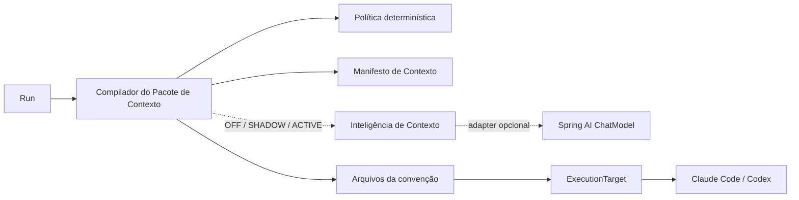
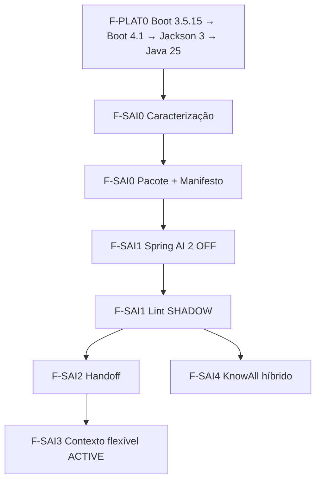

# Plano de implementação — Spring AI no controle de contexto

**Status:** F-PLAT0 + F-SAI0 + F-SAI1 EXECUTADAS em `OFF/SHADOW` · `ACTIVE` e F-SAI2+ NÃO INICIADAS
**Escopo:** Spring AI como inteligência auxiliar do control plane; não como substituto dos runtimes Claude Code/Codex.

## 1. Resultado arquitetural

Migrar o baseline para **Java 25 + Spring Boot 4.1 + Jackson 3 + Spring AI 2.0**, conforme a ADR-0043, e
introduzir um **Pacote de Contexto** determinístico e auditável por Run. O Spring AI entra no comportamento depois,
atrás de um seam local-substituível, para analisar contexto em `SHADOW` e, somente após prova, produzir
**contexto derivado**. O contexto canônico continua verbatim e sob autoridade do produto.

O teste de deleção é o contrato da solução: remover o adapter Spring AI, suas dependências, configuração e
testes específicos deve manter a materialização atual funcionando com os mesmos bytes para Claude e Codex,
em LOCAL e DOCKER.



## 2. Estado atual verificado

- O backend usa Java 25.0.3 + Spring Boot 4.1.0 + Jackson 3; o Maven Wrapper está pinado em 3.9.16.
- O BOM Spring AI 2.0.0 governa a integração e somente o starter Ollama foi adicionado.
- `AdapterRunExecutor` delega a preparação ao seam pequeno `RunContextCompiler`; continua dono do lifecycle,
  publicação LOCAL/DOCKER, sessão, MCP e handoff.
- `run_context_manifest` registra hashes/proveniência sem corpos; `context_assessment` é append-only e persiste
  somente metadados e achados estruturados.
- `CompanyMemoryMaterializer` já entrega dietas distintas: CEO recebe carta + playbook; executor recebe
  playbook + feedback da própria Issue.
- Carta e playbook são projeções determinísticas do `CompanyMemoryConsolidator`; zero LLM no caminho de escrita.
- Sessão nativa é a memória normal; o handoff a 50–60% é uma rede de segurança.
- `SkillSearch` já é um módulo profundo: `PgTrgmSkillSearch` em produção e busca determinística nos testes.
- O projeto prevê `pgvector` para o KnowAll, mas o Decision-log foi deliberadamente definido **sem vetor**.

## 3. Constituição da frente

Estas regras bloqueiam a entrega se forem violadas:

1. **Spring AI não escreve nem reescreve contexto canônico.** Carta, playbook, Decisões, feedback de review,
   SkillSet, hooks, identidade, gates, isolamento e output schema permanecem verbatim/determinísticos.
2. **Toda saída de modelo é contexto derivado.** Ela carrega proveniência, hashes das fontes, versão do prompt,
   modelo, status e motivo de fallback; nunca se torna fonte de verdade.
3. **Falha assimétrica.** Falha na compilação/materialização canônica falha o Run, como hoje. Timeout, resposta
   inválida ou indisponibilidade do Spring AI cai no pacote determinístico e não bloqueia o Run.
4. **Sem terceira memória.** Não usar `ChatMemory` para a execução dos agentes; a continuidade continua nos
   handles nativos, no Workspace e no handoff já existentes.
5. **Sem terceiro compactador concorrente.** Spring AI não disputa o mesmo limiar com a compactação nativa e o
   loop da ADR-0030. Redução ativa alcança somente fontes flexíveis explicitamente permitidas.
6. **Company-scoping e egress explícitos.** Só fontes allowlisted e redigidas podem sair para um provider. Nada
   de prompt/resposta integral em logs ou traces.
7. **Conteúdo é dado não confiável.** A chamada de análise não recebe tools, não executa instruções encontradas
   nos arquivos e produz uma estrutura validada pelo backend.
8. **`.orq/*` permanece fora do replace do escritor.** O Manifesto vive no core/banco; não entra em
   `materializedSubtrees` e não ameaça `.orq/handoff`.
9. **KnowAll e Decision-log não se misturam.** Embeddings futuros indexam somente metadados redigidos de Skills;
   memória de Decisões continua com endereço `#N`, índice enxuto e navegação JIT.
10. **Spring AI não vira `AgentAdapter`.** O contrato atual modela runtimes CLI autônomos com container,
    Workspace, sessão e StepTrace. Um runtime de modelo direto exigiria outro caso de uso e outra decisão.

## 4. Arquitetura alvo

### 4.1 Módulo profundo `context`

O novo módulo concentra a política hoje espalhada pelo `AdapterRunExecutor`, mantendo os materializers atuais
como implementação interna durante a extração:

- `RunContextCompiler`: interface pequena chamada uma vez por Run.
- `ContextPackage`: pacote preparado, com paths a publicar, audiência, prompt/schema já resolvidos e hash final.
- `ContextSource`: fonte identificada por tipo, versão/endereço, hash, tamanho, autoridade e motivo de inclusão.
- `ContextManifest`: registro auditável do que o Run recebeu; não duplica os corpos.
- `ContextPolicy`: classifica fontes em `CANONICAL` ou `DERIVED` e impede omissão/transformação proibida.
- `ContextManifestStore`: persiste o manifesto antes da execução do adapter.

O compilador ganha depth escondendo seleção, ordem, faxina, hashes, estimativa de tamanho e lista de paths. O
`AdapterRunExecutor` continua dono do lifecycle do Run, do `ExecutionTarget` e do `AgentAdapter`.

### 4.2 Seam de inteligência

- `ContextIntelligence`: interface local do domínio; recebe apenas uma visão allowlisted do pacote.
- `NoOpContextIntelligence`: default; zero chamada externa e comportamento atual.
- `SpringAiContextIntelligence`: adapter que traduz a chamada para `ChatClient`/`ChatModel`.
- `ContextAssessment`: resposta estruturada com achados, severidade, fontes envolvidas e ação sugerida.

Nenhuma classe Spring AI atravessa para `execution`, `memory`, `skills` ou `handoff`. Trocar provider ou remover a
biblioteca toca somente o adapter e sua configuração.

### 4.3 Persistência

Reservar a próxima migration livre para duas projeções de auditoria, sem armazenar conteúdo:

**`run_context_manifest` — imutável, 1:1 com Run**

- `run_id`, `company_id`, `agent_id`, `issue_id`, audiência, target e convenção;
- `schema_version`, `compiled_at`, `status`, `final_hash`, bytes e estimativa de tokens;
- `sources jsonb`: id/endereço, versão, hash, classificação, inclusão/omissão e motivo.

**`context_assessment` — append-only, 0..N por manifesto**

- modo, provider/model, versão do prompt e hash das fontes;
- status, cache hit, latência, tokens auxiliares e motivo de fallback;
- achados estruturados; nenhum corpo de fonte ou prompt completo.

O uso auxiliar não entra no cálculo do `HandoffThresholdDetector`: é outra janela. Antes do modo `ACTIVE`, o
custo precisa ganhar governança explícita; não será escondido como custo do agente principal.

## 5. Modos operacionais

| Modo | Efeito no Run | Uso |
|---|---|---|
| `OFF` | pacote 100% determinístico; sem chamada de modelo | default, testes e fallback |
| `SHADOW` | análise assíncrona; diagnóstico não altera arquivos, prompt nem resultado | baseline e calibração |
| `ACTIVE` | só uma transformação allowlisted pode entrar como bloco derivado | canário após ADR e gate humano |

Configuração proposta:

```yaml
orquestrador:
  context:
    intelligence:
      mode: off
      timeout: 5s
      max-input-bytes: 65536
      prompt-version: context-lint-v1
```

Credenciais continuam fora do repositório. Uma assinatura de Claude Code/ChatGPT não equivale a credencial de
API; o provider de inferência auxiliar é uma decisão de deployment separada.

## 6. Fatias de implementação

### Evidência de fechamento das fatias autorizadas — 2026-07-17

- Commits: `ca026ed` (caracterização), `5aade0e` (Boot 3.5.15), `4f31fdd` (Boot 4.1), `bde1e04`
  (Jackson 3), `b183600` (Java 25 + Wrapper), `ef4c315` (BOM Spring AI), `2e21356` (Pacote/Manifesto),
  `1362523` (remoção Jackson 2 residual) e `50db7ff` (`OFF/SHADOW`).
- H2: 757/757 verdes. PostgreSQL/Flyway: V30 verde em banco limpo. Docker: build e execução em Temurin
  25.0.3.
- Claude Code e Codex reais: materialização e Run verdes em LOCAL e DOCKER; continuidade de sessão por handle
  nativo e handoffs com bilhete/retomada exercitados em LOCAL. MCP passou em LOCAL; DOCKER preserva o limite
  deliberado do bridge atual.
- Prova viva de não interferência: Runs OFF LOCAL/DOCKER e o Run SHADOW
  `c6ca1e70-40e3-422d-a8be-ed445beb2682` produziram o mesmo hash final
  `8d558ff61e83441e7755417f9b5f1f749e2c9469c0915350562e278a88b2b2b2`, mesmos 2.471 bytes e
  618 tokens estimados. Com Ollama fora, SHADOW registrou `FALLBACK/TIMEOUT` em 753 ms e o Run terminou
  `SUCCEEDED` com `SHADOW_RUN_OK`.
- Logs não contêm prompt, resposta integral nem corpos. `ACTIVE`, F-SAI2, F-SAI3 e F-SAI4 não foram
  promovidos.

### F-PLAT0 — Migração do baseline (ADR-0043)

**Estado: ✅ concluída.**

**Objetivo:** chegar à matriz Java 25 + Boot 4.1 + Jackson 3 + Spring AI 2.0 sem misturar regressão de
plataforma com ativação de comportamento inteligente.

1. Registrar o baseline completo e atualizar Boot `3.5.0 → 3.5.15` isoladamente.
2. Migrar para Boot `4.1.0` ainda em Java 21; adequar starters modulares, propriedades e APIs removidas.
3. Migrar imports, configuração e testes de Jackson 2 para Jackson 3; uma ponte oficial, se necessária, é apenas
   temporária e deve ser removida antes do fechamento.
4. Elevar `java.version`, `maven.compiler.release`, Docker build/runtime e automação para Java 25; adicionar e
   pinar o Maven Wrapper.
5. Importar o BOM `org.springframework.ai:spring-ai-bom:2.0.0`, ainda sem starter de provider.
6. Rodar suíte completa por fatia e, ao fim, provar PostgreSQL/Flyway, H2, LOCAL/DOCKER e Claude/Codex reais.

**Aceite:** todos os gates da ADR-0043 verdes, árvore de dependências governada pelos BOMs, nenhuma ponte
Jackson 2 residual e zero mudança de comportamento do contexto.

### F-SAI0 — Caracterização + Pacote de Contexto determinístico

**Estado: ✅ concluída.**

**Objetivo:** criar controle e locality sem usar Spring AI no comportamento do Run.

1. Caracterizar por testes os bytes, ordem e paths atuais para:
   - Claude × Codex;
   - CEO × executor;
   - memória vazia × carta/playbook/feedback;
   - LOCAL × lista publicada pelo escritor DOCKER.
2. Extrair a preparação de contexto do `AdapterRunExecutor` para `context/RunContextCompiler`.
3. Preservar `SkillMaterializer`, `HookMaterializer`, `CompanyMemoryMaterializer` e `WorkspaceConvention` como
   implementações internas; não fazer rename/movimentação mecânica na mesma fatia.
4. Persistir `run_context_manifest` e emitir um StepTrace curto com hash, bytes e número de fontes.
5. Reconciliar a estimativa pré-Run com tokens reais já registrados no `cost_event`, sem prometer tokenização
   exata independente de modelo.

**Aceite:**

- hashes finais idênticos ao baseline em todos os cenários;
- nenhum path `.orq/*` publicado pelo writer;
- manifesto não contém corpos, segredos nem PII;
- uma única chamada do executor prepara o pacote;
- suíte atual inteira verde e novos testes de caracterização verdes.

### F-SAI1 — Fundação Spring AI + lint em `SHADOW`

**Estado: ✅ concluída em OFF/SHADOW; ACTIVE continua fora do escopo.**

**Objetivo:** observar valor e risco sem mudar o contexto efetivo.

1. Confirmar o BOM `org.springframework.ai:spring-ai-bom:2.0.0` instalado por F-PLAT0.
2. Adicionar **um** starter de modelo após o gate de provider; não carregar OpenAI + Anthropic + Ollama juntos.
3. Implementar `NoOpContextIntelligence` e `SpringAiContextIntelligence`, condicionais por configuração.
4. Usar `ChatClient` síncrono dentro de um worker limitado, fora de transações e fora do caminho crítico do Run.
5. Pedir `ContextAssessment` estruturado, validar no backend e tratar saída inválida como fallback.
6. Desabilitar tools, memory advisors e log de prompt/resposta; manter apenas observabilidade de metadados.
7. Cachear por `hash-fontes + prompt-version + provider/model`.

**Aceite:**

- `OFF` e `SHADOW` produzem os mesmos hashes de arquivos e o mesmo resultado do Run;
- timeout, 429, 5xx, resposta malformada e exceção sempre resultam em diagnóstico `FALLBACK`, sem falhar o Run;
- nenhum método transacional contém chamada de modelo;
- nenhuma fonte fora da allowlist é enviada;
- métricas mostram chamadas, latência, tokens, cache e fallback; conteúdo não aparece em logs/traces.

### F-SAI2 — Qualidade do handoff

**Estado: ⏳ não iniciada.**

**Objetivo:** melhorar a rede da ADR-0030 sem competir com a sessão nativa.

1. Validar deterministicamente o contrato do bilhete: seções obrigatórias, próximo passo, decisões pendentes e
   ponteiros concretos.
2. Em `SHADOW`, comparar o handoff com as fontes flexíveis permitidas do Run e registrar lacunas/contradições.
3. Montar um conjunto dourado de handoffs reais revisados pelo dono.
4. Só depois permitir uma segunda destilação derivada; o bilhete atual permanece fallback.

**Aceite para sair de `SHADOW`:** conjunto dourado aprovado, zero bloqueio por falso positivo, timeout coberto,
proveniência completa e prova de que carta/playbook/skills não foram enviados ou reescritos.

### F-SAI3 — Seleção/redução de contexto flexível em canário

**Estado: ⏳ não iniciada; exige ADR posterior.**

**Objetivo:** reduzir desperdício de janela sem alterar autoridade.

Fontes inicialmente elegíveis: estado vivo extenso, referências auxiliares e handoffs longos. Fontes proibidas
continuam as dez categorias da Constituição.

1. A política determinística decide quais fontes são elegíveis e o teto máximo; o modelo não escolhe sua própria
   autoridade.
2. O bloco derivado inclui hashes/fontes e é claramente separado das seções canônicas verbatim.
3. Ativação por company e percentual de canário, com kill switch imediato.
4. Comparar tokens de entrada, latência, fallback, retrabalho, review reject e perda de ponteiros.

**Gate sugerido:** promover somente com redução material de tokens flexíveis, zero perda de fonte obrigatória e
sem piora no review/retrabalho. Os números finais são fechados após o baseline de F-SAI1.

### F-SAI4 — Busca híbrida do KnowAll

**Estado: ⏳ não iniciada.**

**Objetivo:** melhorar recall sem tocar o segundo cérebro.

1. Adicionar `EmbeddingModel` e PGvector somente nesta fatia.
2. Indexar `name + description + triggers`; nunca o body da Skill.
3. Tratar vetores como projeção derivada por `skillId + contentHash`; indexação after-commit e reconstruível.
4. Combinar ranking semântico e `pg_trgm` atrás do `SkillSearch` existente.
5. Falha de embedding/vector store usa `PgTrgmSkillSearch` sem degradar a chamada.
6. Preservar `KnowAllMcpBridge` como enforcement de perfil, cap, deduplicação e token por Run.

**Aceite:** recall@5 superior no conjunto rotulado, latência dentro do orçamento, fallback lexical provado e
nenhum vetor criado para Decision-log, carta, playbook ou feedback.

## 7. Ordem, dependências e paralelismo



- F-PLAT0 é sequencial e cada subfatia termina verde; dependências seguem a matriz da ADR-0043.
- F-SAI0 é sequencial: os testes de caracterização protegem a extração.
- Depois do lint `SHADOW`, handoff e experimento do KnowAll podem avançar em paralelo porque usam seams e dados
  distintos.
- F-SAI3 depende dos dados de F-SAI1/F-SAI2 e de uma ADR aceita; não deve ser antecipada.

## 8. Decisões humanas ainda abertas

### H1 — Provider e política de dados para além de `SHADOW`

O provider local de prova foi fechado em Ollama, sem egress externo. Qualquer provider de API ou política de
dados para `ACTIVE` continua pendente: comparar retenção/egress, credencial, qualidade estruturada, p95 e custo
antes de autorizar conteúdo derivado no Run.

### H2 — Promoção para `ACTIVE`

**Recomendação:** manter `SHADOW` até existir baseline suficiente e revisão humana do conjunto dourado. A
ativação que muda o contexto efetivo exige ADR própria posterior (ADR-0044, se continuar sendo a próxima livre)
com: canônico × derivado, allowlist, proveniência, cache, fallback, provider, custo, kill switch e critérios de
desligamento.

A ADR-0043 governa o salto de plataforma. Manifesto e lint em `SHADOW` permanecem reversíveis dentro desse
limite; apenas `ACTIVE` exige a decisão arquitetural posterior.

## 9. O que não fazer nesta frente

- Não criar `SpringAiAgentAdapter`.
- Não migrar a continuidade dos agentes para `ChatMemory`.
- Não usar RAG/pgvector no Decision-log.
- Não permitir que um advisor genérico injete contexto fora da política do compilador.
- Não gravar Manifesto em `.orq/*` nem sincronizar `.orq/` como subtree.
- Não chamar modelo dentro de `@Transactional` ou antes de garantir o fallback determinístico.
- Não ligar `ACTIVE` globalmente sem canário e kill switch.

## 10. Referências verificadas em 2026-07-16

- [Spring Boot 4.1.0](https://spring.io/blog/2026/06/10/spring-boot-4/)
- [Requisitos de sistema do Spring Boot](https://docs.spring.io/spring-boot/system-requirements.html)
- [Spring AI 2.0.0 GA para Spring Boot 4.0/4.1](https://spring.io/blog/2026/06/12/spring-ai-2-0-0-GA-available-now/)
- [Gerenciamento de dependências do Spring Boot](https://docs.spring.io/spring-boot/reference/using/build-systems.html)
- [Guia de migração para Spring Boot 4](https://github.com/spring-projects/spring-boot/wiki/Spring-Boot-4.0-Migration-Guide)
- [Java 25](https://openjdk.org/projects/jdk/25/)
- [ChatClient](https://docs.spring.io/spring-ai/reference/api/chatclient.html)
- [Observabilidade do Spring AI](https://docs.spring.io/spring-ai/reference/observability/index.html)
- [PGvector no Spring AI](https://docs.spring.io/spring-ai/reference/api/vectordbs/pgvector.html)

## 11. Ponteiros do projeto

- `backend/src/main/java/com/orquestrador/execution/AdapterRunExecutor.java`
- `backend/src/main/java/com/orquestrador/memory/CompanyMemoryMaterializer.java`
- `backend/src/main/java/com/orquestrador/memory/CompanyMemoryConsolidator.java`
- `backend/src/main/java/com/orquestrador/execution/adapter/WorkspaceConvention.java`
- `backend/src/main/java/com/orquestrador/handoff/ContextHandoffLoop.java`
- `backend/src/main/java/com/orquestrador/skills/SkillSearch.java`
- ADR-0019, ADR-0022, ADR-0030, ADR-0032, ADR-0038 e ADR-0042.
